<picture>
  <source media="(prefers-color-scheme: dark)" srcset="assets/header-dark.svg">
  
</picture>

 

### Selected work

<a href="https://github.com/SHAILESH-RS-UPADHYAY/tether">
  <picture>
    <source media="(prefers-color-scheme: dark)" srcset="assets/tether-dark.svg">
    
  </picture>
</a>

Reads the open chat in one AI assistant, packs it into a Markdown capsule within a token budget, and types it into another. Manifest V3, no network requests. [Live](https://tether-capsule.vercel.app) and [code](https://github.com/SHAILESH-RS-UPADHYAY/tether)

<a href="https://github.com/SHAILESH-RS-UPADHYAY/blueprint-sh">
  <picture>
    <source media="(prefers-color-scheme: dark)" srcset="assets/blueprint-dark.svg">
    
  </picture>
</a>

Parses JavaScript, TypeScript and Python imports, finds cycles with Tarjan's algorithm and lays the graph out with ELK in a Web Worker. Your code never leaves the browser. [Live](https://blueprint-sh.vercel.app) and [code](https://github.com/SHAILESH-RS-UPADHYAY/blueprint-sh)

<a href="https://github.com/SHAILESH-RS-UPADHYAY/autopsy">
  <picture>
    <source media="(prefers-color-scheme: dark)" srcset="assets/autopsy-dark.svg">
    
  </picture>
</a>

Resolves DNS, reads the TLS certificate and headers, matches signatures and cites an exhibit for every finding. The fetcher only connects to vetted public addresses, so it can't be pointed at a private network. [Code](https://github.com/SHAILESH-RS-UPADHYAY/autopsy)

 

### Activity

<picture>
  <source media="(prefers-color-scheme: dark)" srcset="assets/stats-dark.svg">
  
</picture>

 

### Elsewhere on GitHub

<table>
  <tr>
    <td width="33%" valign="top">
       
      <b><a href="https://github.com/SHAILESH-RS-UPADHYAY/radar">RADAR</a></b> 
      AI job intelligence engine. Scrapes 50+ career pages and matches openings to your resume with embeddings.
    </td>
    <td width="33%" valign="top">
       
      <b><a href="https://github.com/SHAILESH-RS-UPADHYAY/autoflow">AutoFlow</a></b> 
      GenAI workflow automation.
    </td>
    <td width="33%" valign="top">
       
      <b><a href="https://github.com/SHAILESH-RS-UPADHYAY/webvory-scalable-analytics-engine">Analytics Dashboard API</a></b> 
      Ingests 1.3 million e-commerce records and serves analytics in under two seconds.
    </td>
  </tr>
  <tr>
    <td width="33%" valign="top">
       
      <b><a href="https://github.com/SHAILESH-RS-UPADHYAY/devine-cdc">Devine CDC</a></b> 
      Platform for a pediatric therapy clinic.
    </td>
    <td width="33%" valign="top">
       
      <b><a href="https://github.com/SHAILESH-RS-UPADHYAY/simplify-money-backend">Simplify Money</a></b> 
      Gold investment AI backend.
    </td>
    <td width="33%" valign="top">
       
      <b><a href="https://github.com/SHAILESH-RS-UPADHYAY/iota-address-parser">Iota Address Parser</a></b> 
      ML prototype that turns raw address strings into structured JSON.
    </td>
  </tr>
  <tr>
    <td width="33%" valign="top">
       
      <b><a href="https://github.com/SHAILESH-RS-UPADHYAY/finance-dashboard-backend">Finance dashboard backend</a></b> 
      Finance data API with role-based access control.
    </td>
    <td width="33%" valign="top">
       
      <b><a href="https://github.com/SHAILESH-RS-UPADHYAY/food-cart">Food Cart</a></b> 
      Order ahead at campus food stalls and skip the queue.
    </td>
    <td width="33%" valign="top">
       
      <b><a href="https://github.com/SHAILESH-RS-UPADHYAY/luq-prototype">LÜQ</a></b> 
      An emotion-aware character that responds not with words, but with presence.
    </td>
  </tr>
</table>

 

Python, SQL, Linux and the cloud on the backend. TypeScript and Node for tools like the three above.

Say hello on <a href="https://www.linkedin.com/in/shailesh-upadhyay-6a112624a">LinkedIn</a>.
