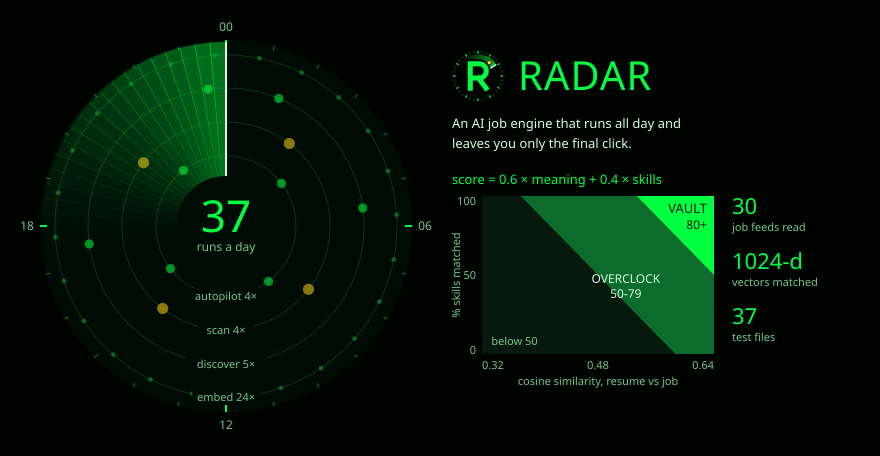
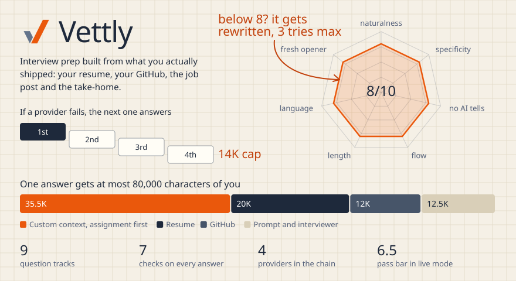
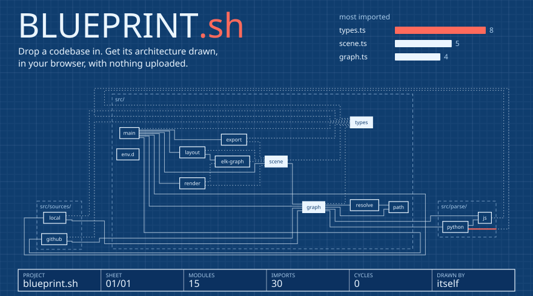
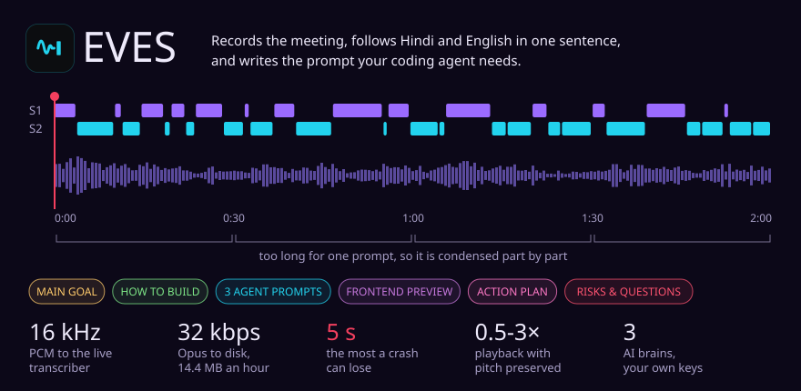
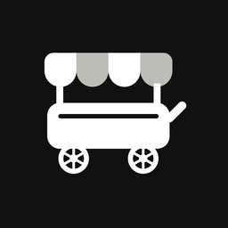
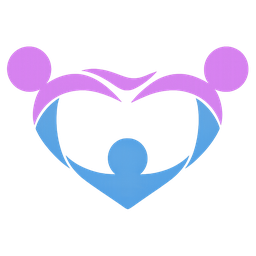

<picture>
  <source media="(max-width: 600px) and (prefers-color-scheme: dark)" srcset="assets/header-dark-m.svg">
  <source media="(max-width: 600px)" srcset="assets/header-light-m.svg">
  <source media="(prefers-color-scheme: dark)" srcset="assets/header-dark.svg">
  
</picture>

<a href="https://shailesh-ai.codes">
<picture>
  <source media="(prefers-color-scheme: dark)" srcset="assets/portfolio-dark.svg">
  
</picture>
</a>

<picture>
  <source media="(max-width: 600px) and (prefers-color-scheme: dark)" srcset="https://shailesh-stats.vercel.app/api/plate?name=pulse&amp;theme=dark&amp;w=m">
  <source media="(max-width: 600px)" srcset="https://shailesh-stats.vercel.app/api/plate?name=pulse&amp;theme=light&amp;w=m">
  <source media="(prefers-color-scheme: dark)" srcset="https://shailesh-stats.vercel.app/api/plate?name=pulse&amp;theme=dark">
  
</picture>

 

### Flagship projects

<a href="work/radar.md">
  <picture>
    <source media="(max-width: 600px)" srcset="assets/plates/radar-m.svg">
    
  </picture>
</a>

An AI job engine. It reads 30 job feeds, finds funded startups on its own, checks every posting is real, scores each one against your resume and files the best in a Vault. Near-misses get an honest resume rewrite. The last click stays yours. **Next.js, Supabase, Pinecone.** <a href="https://radar-neon-theta.vercel.app">Live</a> · <a href="work/radar.md">Case study</a>

 

<a href="work/vettly.md">
  <picture>
    <source media="(max-width: 600px)" srcset="assets/plates/vettly-m.svg">
    
  </picture>
</a>

Interview prep built on your real work. It reads your resume, your GitHub, the job post and the take-home, then asks what only you could be asked and checks every answer for sounding human. **FastAPI, Python, Neon, Clerk.** <a href="https://vettly-sigma.vercel.app">Live</a> · <a href="work/vettly.md">Case study</a>

 

<a href="https://blueprint-sh.vercel.app">
  <picture>
    <source media="(max-width: 600px)" srcset="assets/plates/blueprint-m.svg">
    
  </picture>
</a>

Parses JavaScript, TypeScript and Python imports, finds cycles with Tarjan's algorithm and lays the graph out with ELK in a Web Worker. Your code never leaves the browser. **TypeScript, ELK, hand-written SVG.** <a href="https://blueprint-sh.vercel.app">Live</a> · <a href="https://github.com/SHAILESH-RS-UPADHYAY/blueprint-sh">Code</a>

 

<a href="work/eves.md">
  <picture>
    <source media="(max-width: 600px)" srcset="assets/plates/eves-m.svg">
    
  </picture>
</a>

A desktop app for long engineering calls. It records the meeting, transcribes it live with speaker labels, and turns it into a brief you can question and prompts you can paste. Everything stays on your machine. **React, TypeScript, Deepgram.** <a href="work/eves.md">Case study</a>

 

### By the numbers

<picture>
  <source media="(max-width: 600px) and (prefers-color-scheme: dark)" srcset="https://shailesh-stats.vercel.app/api/plate?name=projects&amp;theme=dark&amp;w=m">
  <source media="(max-width: 600px)" srcset="https://shailesh-stats.vercel.app/api/plate?name=projects&amp;theme=light&amp;w=m">
  <source media="(prefers-color-scheme: dark)" srcset="https://shailesh-stats.vercel.app/api/plate?name=projects&amp;theme=dark">
  
</picture>

<picture>
  <source media="(max-width: 600px) and (prefers-color-scheme: dark)" srcset="https://shailesh-stats.vercel.app/api/plate?name=rhythm&amp;theme=dark&amp;w=m">
  <source media="(max-width: 600px)" srcset="https://shailesh-stats.vercel.app/api/plate?name=rhythm&amp;theme=light&amp;w=m">
  <source media="(prefers-color-scheme: dark)" srcset="https://shailesh-stats.vercel.app/api/plate?name=rhythm&amp;theme=dark">
  
</picture>

<picture>
  <source media="(max-width: 600px) and (prefers-color-scheme: dark)" srcset="https://shailesh-stats.vercel.app/api/plate?name=stack&amp;theme=dark&amp;w=m">
  <source media="(max-width: 600px)" srcset="https://shailesh-stats.vercel.app/api/plate?name=stack&amp;theme=light&amp;w=m">
  <source media="(prefers-color-scheme: dark)" srcset="https://shailesh-stats.vercel.app/api/plate?name=stack&amp;theme=dark">
  
</picture>

These charts are drawn from GitHub when the page loads, so a new commit shows up within a minute. <a href="https://shailesh-stats.vercel.app/api/data">The numbers behind them</a>.

 

### Also built

Every product with its screen and links, in one place: <a href="https://shailesh-ai.codes/#products">shailesh-ai.codes</a>

<b>Autopsy</b> 
Paste a URL, get an evidence-backed teardown of how the site is built. <a href="https://autopsy-casefile.vercel.app">Live</a> · <a href="https://github.com/SHAILESH-RS-UPADHYAY/autopsy">Code</a>
  

<b>Tether</b> 
Carries a chat from one AI assistant to another as a Markdown capsule. <a href="https://tether-capsule.vercel.app">Live</a> · <a href="https://github.com/SHAILESH-RS-UPADHYAY/tether">Code</a>
  

<b>Panna</b> 
A local RAG chatbot that shows its source and refuses when the document does not say it. <a href="https://github.com/SHAILESH-RS-UPADHYAY/panna-rag">Code</a>
  

<b>Simplify Money</b> 
A chat backend for digital gold: reads intent, fetches live prices, logs the purchase. <a href="https://github.com/SHAILESH-RS-UPADHYAY/simplify-money-backend">Code</a>
  

<b>Iota</b> 
An NER engine that turns messy address strings into clean, structured JSON. <a href="https://github.com/SHAILESH-RS-UPADHYAY/iota-address-parser">Code</a>
  

<b>AutoFlow</b> 
Writes the weekly executive report on its own, from the numbers and the company goals. <a href="https://github.com/SHAILESH-RS-UPADHYAY/autoflow">Code</a>
  

<b>LÜQ</b> 
An emotion-aware character that responds not with words, but with presence. <a href="https://github.com/SHAILESH-RS-UPADHYAY/luq-prototype">Code</a>
  

<b>Analytics API</b> 
Ingests 1.3 million e-commerce records and serves analytics in under two seconds. <a href="https://github.com/SHAILESH-RS-UPADHYAY/webvory-scalable-analytics-engine">Code</a>
  

<b>Finance API</b> 
A finance records API with role-based access for admins, analysts and viewers. <a href="https://github.com/SHAILESH-RS-UPADHYAY/finance-dashboard-backend">Code</a>
  

<b>Food Cart</b> 
Order ahead at campus food stalls and skip the queue. <a href="https://food-cart-roan.vercel.app">Live</a> · <a href="https://github.com/SHAILESH-RS-UPADHYAY/food-cart">Code</a>
  

<b>Devine CDC</b> 
The site for a child development centre in Gurugram. <a href="https://devinecdc.in">Live</a> · <a href="https://github.com/SHAILESH-RS-UPADHYAY/devine-cdc">Code</a>
  

LLMs, RAG and agents first. Python and FastAPI behind them, TypeScript and Next.js for everything people touch. Say hello on <a href="https://www.linkedin.com/in/shailesh-upadhyay-6a112624a">LinkedIn</a>.
