<picture>
  <source media="(prefers-color-scheme: dark)" srcset="assets/header-dark.svg">
  
</picture>

 

### Selected work

<a href="https://github.com/SHAILESH-RS-UPADHYAY/tether">
  <picture>
    <source media="(prefers-color-scheme: dark)" srcset="assets/tether-dark.svg">
    
  </picture>
</a>

Reads the open chat in one AI assistant, packs it into a Markdown capsule within a token budget, and types it into another. Manifest V3, no network requests. [Code](https://github.com/SHAILESH-RS-UPADHYAY/tether)

<a href="https://github.com/SHAILESH-RS-UPADHYAY/blueprint-sh">
  <picture>
    <source media="(prefers-color-scheme: dark)" srcset="assets/blueprint-dark.svg">
    
  </picture>
</a>

Parses JavaScript, TypeScript and Python imports, finds cycles with Tarjan's algorithm and lays the graph out with ELK in a Web Worker. Your code never leaves the browser. [Live](https://blueprint-sh.vercel.app) and [code](https://github.com/SHAILESH-RS-UPADHYAY/blueprint-sh)

<a href="https://github.com/SHAILESH-RS-UPADHYAY/autopsy">
  <picture>
    <source media="(prefers-color-scheme: dark)" srcset="assets/autopsy-dark.svg">
    
  </picture>
</a>

Resolves DNS, reads the TLS certificate and headers, matches signatures and cites an exhibit for every finding. The fetcher only connects to vetted public addresses, so it can't be pointed at a private network. [Code](https://github.com/SHAILESH-RS-UPADHYAY/autopsy)
