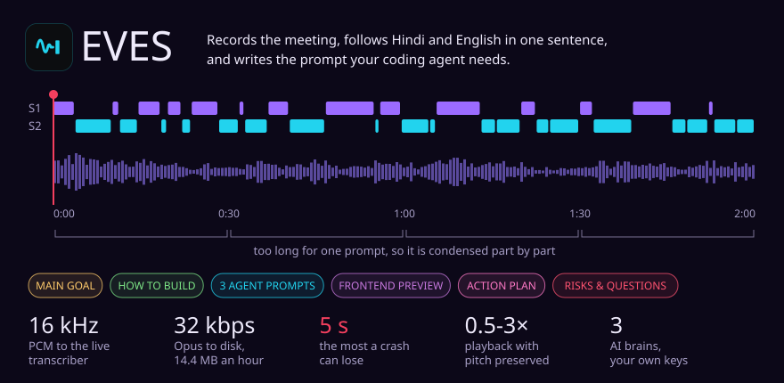

# EVES

A desktop app that records long engineering calls and turns them into what you actually need next: the goal, the plan and a prompt you can paste.

<picture>
  <source media="(max-width: 600px)" srcset="../assets/plates/eves-m.svg">
  
</picture>

## The problem

Calls that run past two hours pack in decisions, trade-offs and things deliberately ruled out. You remember the headline and lose the reasoning somewhere between the call and the keyboard. A summary gets read once and forgotten. A prompt gets used.

## The workflow

1. **Record.** A floating popup captures system audio, your mic, or both. It streams to the transcriber and writes the recording to disk as it goes.
2. **Transcribe.** Live, with speaker labels. Hindi and English in the same sentence is the normal case here, not an edge case.
3. **Condense.** A long meeting doesn't fit in one prompt, so it is digested part by part until it does, keeping every decision, task and number with its time and speaker.
4. **Ask.** Attach your company repo and your skill notes, then question the meeting by typing or by voice. Answers cite the exact moment.
5. **Paste.** Eight one-tap outputs, from the main goal to a risks list and three prompts ready for different coding agents.

## Why long meetings don't break it

| | |
|---|---|
| **Crash safety** | The recording is flushed to disk every 5 seconds, so a crash costs at most 5 seconds |
| **Storage** | 32 kbps Opus, about 14.4 MB an hour, so a 2-hour call is under 30 MB |
| **Transcription** | 16 kHz PCM over a WebSocket, with timestamps that survive a reconnect |
| **Playback** | Opens instantly from captured peaks, seeks over HTTP ranges, plays at 0.5x to 3x with pitch preserved |

## What's under it

| | |
|---|---|
| **App** | React 18, TypeScript 5.5, Zustand, wavesurfer.js, a Node core process |
| **Speech** | Deepgram nova-3 in multilingual mode |
| **Brains** | Groq, Gemini or OpenAI through one small client, switching on its own when a provider retires a model |
| **Privacy** | Keys, transcripts and audio stay on your machine. Files that look like secrets are never read into a prompt |
| **Size** | About 12,900 lines and 110 modules, no import cycles |

The code is private. Happy to walk through it. <a href="../README.md">Back to the profile</a>
