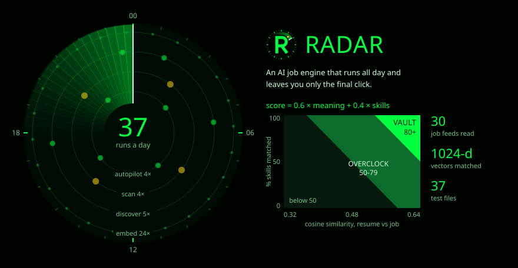

<p></p>

# RADAR

An AI job engine that runs all day and leaves you only the final click.

<picture>
  <source media="(max-width: 600px)" srcset="../assets/plates/radar-m.svg">
  
</picture>

## The loop

1. **Discover.** Finds funded startups on directories and hiring lists, then follows each company's own job links to work out which applicant tracking system it uses. It obeys robots.txt, names itself honestly, and pauses as soon as a site says slow down.
2. **Ingest.** Reads 30 feeds: 14 applicant tracking systems and 16 job boards. Unchanged jobs are never embedded twice, and no single company can hold up a run.
3. **Match.** Every job gets one score from 0 to 100 against your resume.
4. **Verify.** A job board posting has its apply link opened first. A 404 or a "no longer accepting applications" keeps it out, and every saved job is checked again each day.
5. **Tailor.** Near-misses get a resume rewrite for that one job, using only what is already true. The same scorer then projects the new score.
6. **Apply.** A Chrome extension opens the form already filled, with every question answered. You press Submit. Replies from recruiters then move the application along on their own.

## How a job earns its place

```text
meaning = (cosine similarity - 0.32) / 0.32, clamped to 0..100
skills  = your skills that the job lists / skills the job lists x 100
score   = 0.6 x meaning + 0.4 x skills
```

Then the things a similarity score cannot know move it: a title that matches a role you want, a role asking for years you don't have, the location, how fresh the posting is. **80 and above** goes to the Vault on its own. **50 to 79** is a near-miss worth tailoring for.

The similarity band belongs to the embedding model. When I changed models I measured where real resumes landed and moved the band to match, rather than keeping numbers that had stopped meaning anything.

## What's under it

| | |
|---|---|
| **App** | Next.js 16, React 19, TypeScript in strict mode |
| **Data** | Supabase Postgres, Pinecone with 1024-dimension vectors |
| **Schedule** | 37 cron runs a day: embed 24, discover 5, scan 4, autopilot 4 |
| **AI** | Four providers, each a fallback for the others |
| **Safety** | Read-only Gmail link with the token sealed by AES-256-GCM. Only the verdict on a reply is stored |
| **Size** | About 34,000 lines and 200 modules, no import cycles, 37 test files |

## What it refuses to do

No LinkedIn or Indeed scraping, no fake browsers or rotating IPs, no CAPTCHA solving, and your logins are never used. The final submit on every application is yours.

<sub>The code is private. Happy to walk through it. <a href="../README.md">Back to the profile</a></sub>
