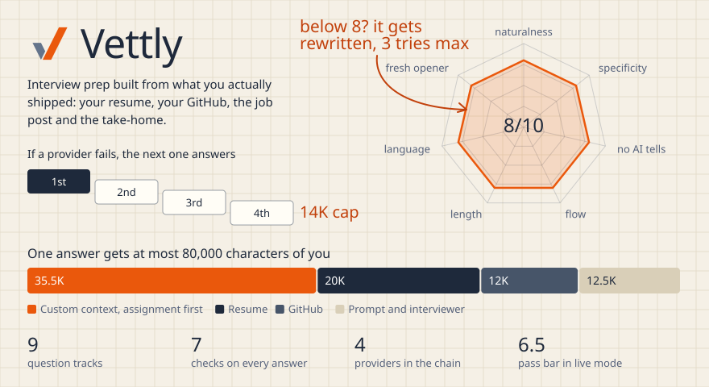

# Vettly

Interview prep built on what you actually shipped, not on a list of flashcards.

<picture>
  <source media="(max-width: 600px)" srcset="../assets/plates/vettly-m.svg">
  
</picture>

[Open the live app](https://vettly-sigma.vercel.app)

## The idea

Generic prep gives you generic answers. Vettly reads your resume, your public GitHub repos, the job post and any take-home, then asks what only you could be asked, and helps you answer in your own voice.

## How an answer gets made

1. **Context.** Everything about you is packed into a budget of at most 80,000 characters, with a take-home assignment always placed first in its section.
2. **Question.** Nine tracks, from behavioral and system design to project deep-dives and the assignment itself, checked against recent questions so they don't repeat.
3. **Draft.** A router tries four AI providers in order. If one fails or rate limits, the next one answers. The last hop is capped at 14,000 characters so an oversized request can't take it down too.
4. **Check.** Each answer is scored out of 10 on seven things: naturalness, specificity, no AI tells, conversational flow, length, language consistency and a varied opening. Below 8, it is rewritten with specific feedback, up to three times. In a live session the bar drops to 6.5 and there is one pass, because speed matters more there.
5. **Learn.** Corrections you make in chat become permanent rules.

## What's under it

| | |
|---|---|
| **Backend** | FastAPI, Python, a WebSocket for live voice through Deepgram |
| **Hosted mode** | Clerk sign-in and Neon Postgres, each person with a private data space |
| **Local mode** | One double-click launcher, no sign-in, data on your own disk |
| **Tested** | Two users never see each other's data, bad tokens are refused, the daily AI allowance holds |
| **Size** | About 13,600 lines across 42 modules |

The code is private. Happy to walk through it. <a href="../README.md">Back to the profile</a>
